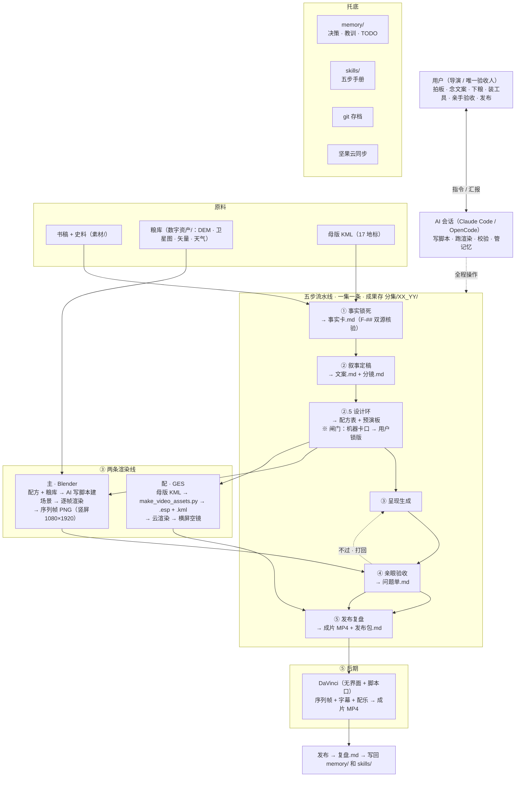

# 项目总架构图（含数据流）

> 落盘 2026-10-15 ｜ 用途：**接手第一站**——先看这张图，再看细节文档。
> 关联：`设计稿_11终章首跑.md`（流水线细节）、`memory/decisions.md` ADR-012（工具落定）、`.claude/skills/video-pipeline/SKILL.md`（五步手册）。
> 维护：结构有增减（新环节 / 新工具 / 数据流变化）时更新本图，并回查根目录 `CLAUDE.md` / `AGENTS.md` 文件角色表。
> 现状注（2026-10-15）：Blender 待装、DaVinci 待定位、粮库待入库（P0）。

## 一、主图（总览）

```text
━━━━━━━━━━━━━━━━━━━━━━━━━━━━━━━━━━━━━━━━━━━━━━━━━━━━━
     《中央帝国的军事密码》· 视频工程总架构（含数据流）
 数据链：书稿→事实卡→文案·分镜→配方表→序列帧→成片→发布→复盘
━━━━━━━━━━━━━━━━━━━━━━━━━━━━━━━━━━━━━━━━━━━━━━━━━━━━━

用户（拍板·念稿·验收·发布）   ⇅ 指令 / 汇报
AI 会话（Claude Code / OpenCode）：写脚本·跑渲染·校验·管记忆
   │
   ▼
【原料】
  书稿+史料（素材/）                      → 事实来源
  粮库（数字资产/：DEM·卫星图·矢量·天气）  → 画面原料
  母版KML（17地标）                       → 路线骨架 / GES 配菜线
   │
   ▼
【五步流水线 · 一集一条 · 成果存 分集/<集名>/】
  ① 事实锁死   书稿+史料+母版KML ──→ 事实卡.md（F-##，双源核验）
  ② 叙事定稿   事实卡 ──→ 文案.md + 分镜.md
  ②.5 设计环   文案+分镜+粮库清单+模板·风格 ──→ 配方表（三证栏）+ 预演板
               ※ 闸门：机器卡口 → 用户锁版签名（不锁版不渲染）
  ③ 呈现生成
     主 │ Blender：配方表+粮库数据 → AI 写脚本建场景 → 逐帧渲染
        │          → 序列帧 PNG（竖屏 1080×1920）
     配 │ GES：母版KML → make_video_assets.py → .esp+.kml（视频制作/）
        │      → GES 云渲染 → 横屏空镜（进⑤作配菜/备用）
  ④ 亲眼验收   用户亲手播样片 ──→ 问题单.md（不过 → 打回③）
  ⑤ 出厂       序列帧+字幕+配乐 ──→ DaVinci（无界面+脚本口）
               ──→ 成片 MP4（竖屏 1080×1920）+ 发布包.md（封面·标题·节奏表）
   │
   ▼
【发布与回写】发布 → 复盘.md → 写回 memory/ 和 skills/（下集只改一处）
   │
   ▼
【托底】memory/（决策·教训·TODO）｜skills/（五步手册）｜git 存档｜坚果云同步
        口诀：几何正确归机器，观感受众归后期
```

## 二、分层详图

```text
【分层详图】从上往下：谁 → 干什么 → 用什么 → 放哪 → 靠什么托底

【人层】用户（唯一人工，只做只有人能干的事）
   拍板 · 念文案 · 下粮 · 装工具 · 亲手验收 · 发布
        ↑ 汇报 ┊ 指令 ↓
【AI 会话层】Claude Code / OpenCode（可多会话并行）
   写脚本 · 跑渲染 · 校验 · 管记忆 · 汇报
        ↓ 按五步操作（一集一条，单向不回头）
【流程层】①事实锁死 → ②叙事定稿 → ②.5设计环 → ③呈现生成 → ④亲眼验收 → ⑤发布复盘
        ↓ 调用
【工具层】全部 AI 后台驱动，用户不开软件
   主渲染 Blender（待装）┊ 配菜 GES（云渲染）┊ 后期 DaVinci（待定位）
   辅助 make_video_assets.py（GES 线生成/校验）┊ fetch_dem.py（下粮）
        ↓ 读写
【数据层】所有东西的存放地
   素材/（书稿）┊ 数字资产/（粮库：DEM·卫星图·矢量·天气）┊ 分集/（工作纸）
   视频制作/（GES 素材）┊ memory/（记忆）
        ↓
【基建层】git 存档（每步可回退）┊ 坚果云（跨机同步）┊ skills/（五步手册+抽屉）
```

## 三、mermaid 存图版（贴到 mermaid.live 导出图片用）


